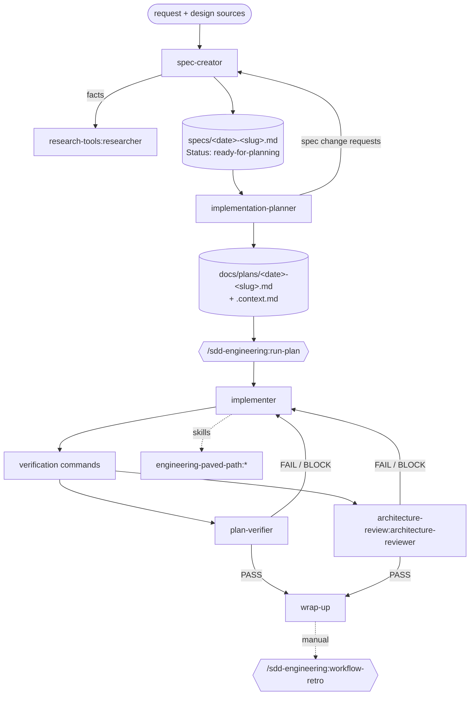

# sdd-engineering

Spec Driven Development for Claude Code. A feature goes from request to reviewed code through
fixed artifacts — a spec, a plan, review reports — each produced by an agent with one job and
checked by an independent one.

```
/plugin marketplace add podop/dev-digest-ai-marketplace
/plugin install sdd-engineering@dev-digest-ai-marketplace
```

The installer also installs the dependencies `engineering-paved-path`, `research-tools` and
`architecture-review`.

## How it works together



Three manual phases, each started by you, usually in its own session; artifacts pass by path.

| Phase | Start it with | Produces |
|---|---|---|
| 1. Spec | `claude --agent sdd-engineering:spec-creator` | `specs/<YYYY-MM-DD>-<slug>.md` — scenarios, FR/EC/NFR, acceptance criteria with `Traces:` and `Verify:`, open questions. You approve it (`Status: ready-for-planning`). |
| 2. Plan | `claude --agent sdd-engineering:implementation-planner` | `docs/plans/<YYYY-MM-DD>-<slug>.md` + `.context.md` — steps with files, skills, tests, `Covers: AC…`, waves, verification. You approve it (`Status: approved`). |
| 3. Implement + review | `/sdd-engineering:run-plan docs/plans/<plan>.md` | code and tests; review reports in `.sdd/review/<slug>/`; fix rounds until both reviewers pass. |
| Retro (optional) | `/sdd-engineering:workflow-retro <slug>` in the same session | per-agent tokens, cache hit, time, cost; ≤ 5 action items; one row in `docs/retros/ledger.md`. |

Paths follow your repository first: if `CLAUDE.md` / `AGENTS.md` names a place for specs or
plans, the agents use it; a path you name in the request wins over both.

## Components

| Component | Kind | Model | Writes | Role |
|---|---|---|---|---|
| `spec-creator` | agent | opus | spec files only | gap analysis, blocking questions, traceable spec; no implementation details |
| `implementation-planner` | agent | opus | the plan + context pack only | checks the spec is plannable, never invents requirements, maps files to skills, plans waves |
| `implementer` | agent | sonnet | code + tests | executes the plan or a fix brief, loads skills per touched file, runs verification |
| `plan-verifier` | agent | sonnet | its report only | one row per plan item and acceptance criterion with evidence; scope check |
| `run-plan` | skill (manual) | — | `.sdd/review/<slug>/` snapshots | orchestrates implementer → reviewers → fix rounds on the delta |
| `workflow-retro` | skill (manual) | — | one ledger row | measures a finished run from the session transcript |
| `engineering-insights` | skill | — | `INSIGHTS.md` (append-only) | reads lessons before work; appends new, verified, non-obvious ones at wrap-up |

From dependencies: `research-tools:researcher` (spec-creator's fact finder),
`architecture-review:architecture-reviewer` (second reviewer in the gate),
`engineering-paved-path:*` skills (technical rules the planner cites and the implementer follows).

Supporting files are inside the plugin and survive installation:
`references/conventions.md` (paths, statuses, verification discovery, skill routing, hand-off
rules — read through `${CLAUDE_PLUGIN_ROOT}`), `scripts/spec_lint.py` (spec structure and AC
coverage), `skills/run-plan/scripts/review_delta.py` (round snapshots),
`skills/workflow-retro/scripts/analyze_journals.py` and `skills/engineering-insights/scripts/append_insight.py`
(both through `${CLAUDE_SKILL_DIR}`).

## Quick start in your repository

```bash
# 1. spec — answer its questions, approve the draft
claude --agent sdd-engineering:spec-creator
> Add a priority (low/medium/high) to todos and let the list filter by it.

# 2. plan — approve it
claude --agent sdd-engineering:implementation-planner
> Plan specs/2026-10-15-todo-priority.md

# 3. implement + review
claude
> /sdd-engineering:run-plan docs/plans/2026-10-15-todo-priority.md
> /sdd-engineering:workflow-retro todo-priority      # optional, same session
```

Add `.sdd/` to `.gitignore`; it holds review reports and round snapshots.

## What the agents need from your repository

- **Instructions** — `CLAUDE.md` / `AGENTS.md` with structure and conventions. The agents defer to
  them; nothing here overrides your project rules.
- **Verification commands** — found in the plan, your instructions, `package.json` / `Makefile` /
  `pyproject.toml` / `go.mod` / `pom.xml` / `build.gradle` / `Cargo.toml`, or CI workflows. **If no
  test command is found**, the planner writes `Verification: no test command found` and asks you;
  the implementer reports `Gates: NOT RUN — no test command found` with `STATUS: PARTIAL`; the
  plan-verifier marks test-dependent rows `CANNOT_VERIFY`. Nobody invents a command.
- **Architecture rules (optional)** — `ARCHITECTURE.md`, ADRs or a dependency-cruiser config make
  the architecture review sharper; without them it reports "no documented architecture" and
  caps generic findings at MEDIUM.

## Guarantees

- Writers run one at a time; reviewers are read-only and run in a fresh context.
- Nothing commits, pushes or installs dependencies on its own.
- `run-plan` and `workflow-retro` start only when you call them (`disable-model-invocation`).
- Unrelated requests do not start the workflow (negative eval).

## Evals

`evals/` holds behavior evals for the fixed scenario "spec and plan for a small feature" plus a
"no test command" edge case and a negative case. See [evals/README.md](evals/README.md):

```bash
claude plugin eval ./plugins/sdd-engineering --trust-plugin --scaffold --allow-tools Write Edit --ablation none --no-publish
```

Owner: AI Engineering · License: MIT · Changes: [CHANGELOG.md](CHANGELOG.md) ·
Requirements: [COMPATIBILITY.md](COMPATIBILITY.md) · Releases and rollback:
[docs/RELEASES.md](../../docs/RELEASES.md)
