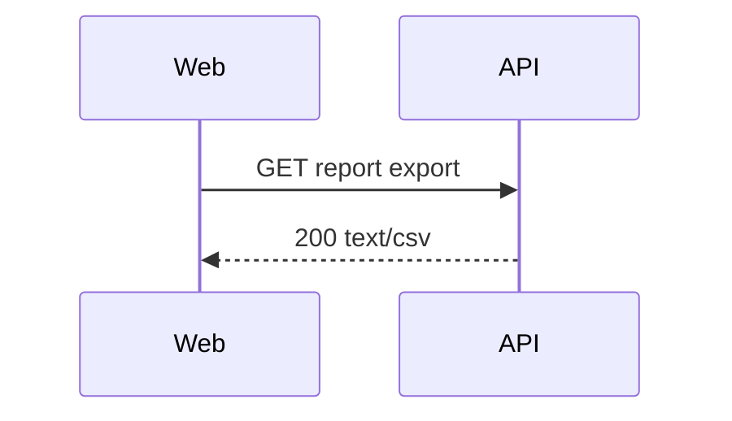

# Export report as CSV
Spec: Export report as CSV · Status: draft · Date: 2026-01-15
Areas: api, web
Design sources: text description from the request

## 1. Goal
Users can download the current report as a CSV file.

## 3. Scope
### In scope
- CSV export of the visible report rows.
### Out of scope
- No PDF export is offered.

## 5. Functional requirements
- FR1 [api] — The system shall return the report rows as CSV with a header row.
- FR2 [web] — The report screen shall offer an "Export CSV" button.
- ~~FR3 [web] — Dropped: XLSX export.~~

## 6. Workflow and communication

## 10. Edge cases
- EC1 [api] — The report has zero rows → the CSV contains only the header row (FR1).

## 11. Non-functional requirements
- NFR1 [api] — An export of 10 000 rows completes within 2 s.

## 13. Acceptance criteria
- AC1 [api] — Given a report with 3 rows, when the export is requested, then the response
  is `text/csv` with 4 lines.
  Traces: FR1 · Verify: integration
- AC2 [web] — Given the report screen, when the user clicks "Export CSV", then a file
  download starts.
  Traces: FR2 · Verify: component
- AC3 [api] — Given an empty report, when the export is requested, then the response has
  only the header line.
  Traces: EC1 · Verify: unit
- AC4 [api] — Given 10 000 rows, when the export is requested, then it completes in ≤ 2 s.
  Traces: NFR1 · Verify: integration

## 14. Traceability
| Source | Area | FR | EC / NFR | AC |
|---|---|---|---|---|
| request | api | FR1 | EC1, NFR1 | AC1, AC3, AC4 |
| request | web | FR2 | | AC2 |

## 17. Open questions
- none
